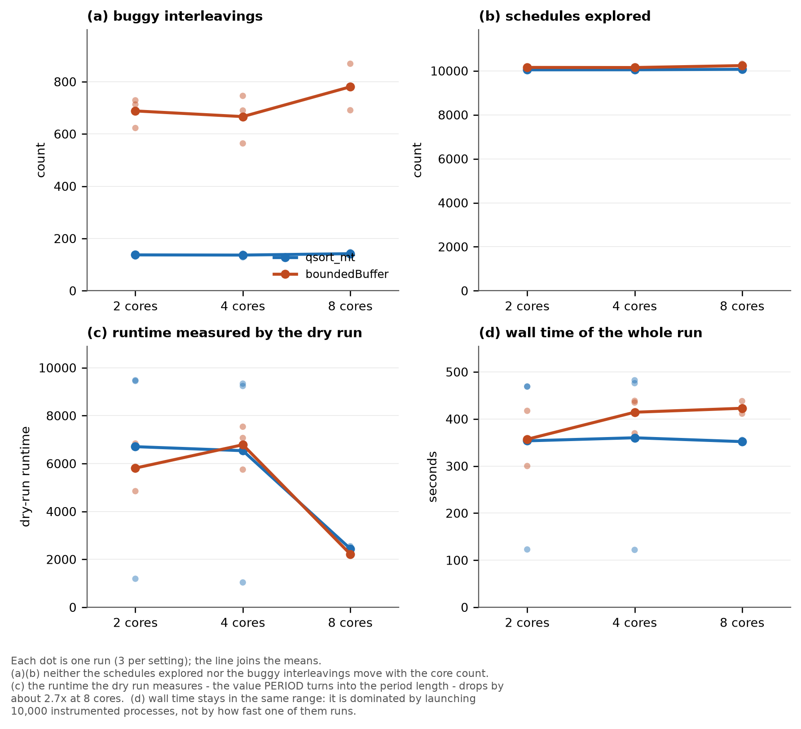

# CS340 Reproduction — Period (ICSE 2022)

Course project: **Research Paper Replication**, CS340 Operating Systems (2026–2027).

---

## 1. Purpose

This repository reproduces the main claims of:

> **Controlled Concurrency Testing via Periodical Scheduling**
> Cheng Wen, Mengda He, Bohao Wu, Zhiwu Xu, Shengchao Qin — ICSE 2022

- Paper: <https://wcventure.github.io/pdf/ICSE2022_PERIOD.pdf>
- DOI: 10.1145/3510003.3510178
- Upstream artifact: <https://github.com/wcventure/PERIOD> (MIT License)

PERIOD is a controlled concurrency testing (CCT) tool. It models the execution
of a concurrent program as **periodical execution**: context switches become
period switches, implemented with the Linux `SCHED_DEADLINE` policy, so no
preemption or sleep delay is needed and threads may still run in parallel
within a period.

**Claims tested:**

| ID | Claim | Evidence in paper |
|----|-------|-------------------|
| **C1** | PERIOD detects all 10 buggy programs in the CVE benchmark, whereas existing CCT techniques detect only 7. | Table 1 |
| **C2** | PERIOD incurs a 2–30× runtime slowdown relative to native execution, well below the 10–500× of IPB/IDB/PCT. | Figure 7 |

---

## 2. Environment

### 2.1 Paper's setup (ICSE 2022, §4.1.3)

| Component | Value |
|-----------|-------|
| CPU | Intel Xeon Silver 4214 (12 cores / 24 threads) |
| OS | Ubuntu 18.04 |
| GCC | 7.5 |
| LLVM | 10.0 |
| Schedule depth | 5 (CVE benchmark) / 3 (SCTBench) |
| Schedule budget | 10,000 schedules per invocation |

### 2.2 Our setup

| Component | Value |
|-----------|-------|
| Host | Windows 11 + VMware Workstation 26 |
| Guest OS | Ubuntu 26.04 LTS |
| Kernel | 7.0.0-43-generic |
| CPU | 8 vCPU (1 socket × 8 cores, no SMT) |
| Memory | 16 GB |
| Docker | 29.1.3 (`docker.io` 29.1.3-0ubuntu4.1) |
| PERIOD image | `wcventure/period:stable` |
| Image digest | `sha256:8f47d8b9148f2db579627842026e722d0f205ddeab13e70ee41a8df3dbd59fbc` |
| Side-channel mitigations | enabled (host default) |

All differences from the paper are listed in [`docs/deviations.md`](docs/deviations.md).

---

## 3. Installation

Full procedure: **[INSTALL.md](INSTALL.md)** — includes the network workaround
we needed because `registry-1.docker.io` is unreachable from our testbed.

Short version:

```bash
sudo apt install -y docker.io
sudo docker pull wcventure/period:stable
sudo docker tag wcventure/period:stable period:latest
```

---

## 4. Testing

Full procedure: **[TEST.md](TEST.md)**.

Short version:

```bash
sudo docker run --privileged -it period:latest /bin/bash
# inside the container:
source /workdir/PERIOD/tool/init_env.sh
cd $ROOT_DIR/test/doubleFree
./cleanDIR.sh && ./build.sh
$ROOT_DIR/tool/DBDS/run_PDS.py -y -d 3 ./df
```

Expected final lines:

```
Total Error Interleavings: 4
Total Timeouts Interleavings: 0
```

## 5.claim2


### Build

All ten programs are built with the upstream batch script. This is the exact
sequence recorded in [`logs/claim2log/cve/build_all.log`](logs/claim2log/cve/build_all.log):

```bash
# inside the container, at the repository root
cd /workdir/PERIOD
source tool/init_env.sh

# compile all ten ConVul-CVE-Benchmarks programs
cd $ROOT_DIR/evaluation/ConVul-CVE-Benchmarks
./build_all.sh
```

`build_all.sh` runs `cleanDIR.sh`, the LLVM bitcode step, `staticAnalysis.sh`
and the DBDS instrumentation for each program. It takes about 3 minutes.

### Run

Schedule depth `-d 5` and `-y` (skip the interactive prompt) are the settings
used for this benchmark throughout the paper. The binary name is the directory
name without the `CVE-` prefix:

```bash
cd $ROOT_DIR/evaluation/ConVul-CVE-Benchmarks/CVE-2009-3547
$ROOT_DIR/tool/DBDS/run_PDS.py -y -d 5 ./2009-3547
```

| Program | Binary |
|---|---|
| CVE-2009-3547 | `2009-3547` |
| CVE-2011-2183 | `2011-2183` |
| CVE-2013-1792 | `2013-1792` |
| CVE-2015-7550 | `2015-7550` |
| CVE-2016-1972 | `2016-1972` |
| CVE-2016-1973 | `2016-1973` |
| CVE-2016-7911 | `2016-7911` |
| CVE-2016-9806 | `2016-9806` |
| CVE-2017-6346 | `2017-6346` |
| CVE-2017-15265 | `2017-15265` |

### Expected output

Every program ends with a summary block; `Total Error Interleavings` must be
greater than zero, otherwise PERIOD did not detect the bug:

```
End Testing!

Total Error Interleavings: 3
Total Timeouts Interleavings: 0
```

For CVE-2009-3547 we get 3 error interleavings on every run; the per-program
numbers we measured are in [`claim2cve.md`](claim2cve.md).

### Runtime

- `./build_all.sh`: about 3 minutes.

Measure with `/usr/bin/time -f "%e s" $ROOT_DIR/tool/DBDS/run_PDS.py -y -d 5 ./2009-3547`
if you need to re-measure on another machine.

The process and results of reproducing this experiment are in
[`claim2cve.md`](claim2cve.md).

Upstream per-program instructions:
[CVE-2009-3547](https://github.com/wcventure/PERIOD/tree/main/evaluation/ConVul-CVE-Benchmarks/CVE-2009-3547) ·
[CVE-2011-2183](https://github.com/wcventure/PERIOD/tree/main/evaluation/ConVul-CVE-Benchmarks/CVE-2011-2183) ·
[CVE-2013-1792](https://github.com/wcventure/PERIOD/tree/main/evaluation/ConVul-CVE-Benchmarks/CVE-2013-1792) ·
[CVE-2015-7550](https://github.com/wcventure/PERIOD/tree/main/evaluation/ConVul-CVE-Benchmarks/CVE-2015-7550) ·
[CVE-2016-1972](https://github.com/wcventure/PERIOD/tree/main/evaluation/ConVul-CVE-Benchmarks/CVE-2016-1972) ·
[CVE-2016-1973](https://github.com/wcventure/PERIOD/tree/main/evaluation/ConVul-CVE-Benchmarks/CVE-2016-1973) ·
[CVE-2016-7911](https://github.com/wcventure/PERIOD/tree/main/evaluation/ConVul-CVE-Benchmarks/CVE-2016-7911) ·
[CVE-2016-9806](https://github.com/wcventure/PERIOD/tree/main/evaluation/ConVul-CVE-Benchmarks/CVE-2016-9806) ·
[CVE-2017-6346](https://github.com/wcventure/PERIOD/tree/main/evaluation/ConVul-CVE-Benchmarks/CVE-2017-6346) ·
[CVE-2017-15265](https://github.com/wcventure/PERIOD/tree/main/evaluation/ConVul-CVE-Benchmarks/CVE-2017-15265)

These commands are adapted from the upstream
[README](https://github.com/wcventure/PERIOD); the upstream source is used
unmodified.


## Inspect subset (paper Table 2)

### Build

Both programs live under `$ROOT_DIR/evaluation/Inspect_benchmarks/`. Build with
the per-program script:

```bash
cd $ROOT_DIR/evaluation/Inspect_benchmarks/qsort_mt
./cleanDIR.sh && ./build.sh

cd $ROOT_DIR/evaluation/Inspect_benchmarks/boundedBuffer
./cleanDIR.sh && ./build.sh
```

### Run

```bash
cd $ROOT_DIR/evaluation/Inspect_benchmarks/qsort_mt
$ROOT_DIR/tool/DBDS/run_PDS.py -y -d 3 -f 10000 ./qsort_mt -n 32 -f 4 -h 3 -v

cd $ROOT_DIR/evaluation/Inspect_benchmarks/boundedBuffer
$ROOT_DIR/tool/DBDS/run_PDS.py -y -d 3 -f 10000 ./boundedBuffer
```
You can also use the simplified code I created using AI. 
The advantage is that you can run it three times in one go, 
and the logs will be stored in the virtual machine. 
When you exit the container, the logs will not disappear

```bash
  mkdir -p /root/period-logs-cores
  cd $ROOT_DIR/evaluation/Inspect_benchmarks/boundedBuffer
  for i in 1 2 3; do
    log=/root/period-logs-cores/boundedBuffer_vm2_run$i.log
    t0=$(date +%s)
    /workdir/PERIOD/tool/DBDS/run_PDS.py -y -d 3 -f 10000 ./boundedBuffer > $log 2>&1
    t1=$(date +%s)
    echo "vm2 run$i | $(grep -ah 'Total Error' $log|head -1) | $(grep -ah '^Round' $log|head -1) | wall=$((t1-t0))s"
  done
```


```bash
mkdir -p /root/period-logs-cores
cd $ROOT_DIR/evaluation/Inspect_benchmarks/qsort_mt

for i in 1 2 3; do
  log=/root/period-logs-cores/qsort_mt_vm2_run$i.log
  t0=$(date +%s)
  /workdir/PERIOD/tool/DBDS/run_PDS.py -y -d 3 -f 10000 ./qsort_mt -n 32 -f 4 -h 3 -v > $log 2>&1
  t1=$(date +%s)
  echo "vm2 qs run$i | $(grep -ah 'Total Error' $log|head -1) | $(grep -ah '^Round' $log|head -1) | wall=$((t1-t0))s"
done
```

The process and results of reproducing this experiment are in
[`sctinspect.md`](sctinspect.md).

***

## 6. claim 3 (runtime overhead, RQ3)

Reproduction of the second claim of the paper: **PERIOD is 2–30× slower than
native execution** (Figure 7, §4.4). The IPB/IDB/PCT baselines were **not**
reproduced: their SCTBench implementations are based on Pin, which requires a
kernel ≤ 3.x, while PERIOD requires kernel ≥ 4.x — the two cannot run in one
environment. The reasons and impact are covered in the deviations section of
the final report.

The VM and environment are described in section 2.2; the instrumented PERIOD
build (`build_all.sh`) is described in section 5 and is not repeated here.

### Build

Each program additionally gets a **native build** from the same unmodified
upstream source (no PERIOD instrumentation, no ASan), used as the denominator
of the slowdown:

```bash
# inside the container, at the repository root
source tool/init_env.sh
bash scripts/rq3/build_native.sh     # builds all 10 *_native binaries
```

### Run

The measurement scripts write all logs to `RQ3/<CVE-dir>/` (one folder per
program, one file per run); they are uploaded under
[`logs/claim2log/rq3/`](logs/claim2log/rq3/):

```bash
# native wall-clock timing (default 3 valid runs)
bash scripts/rq3/time_native.sh CVE-2016-7911 2016-7911_native 3
# PERIOD measurement (default 3 runs, single-run timeout 1800 s)
bash scripts/rq3/run_period.sh CVE-2016-7911 2016-7911 3
```

Both scripts are executed for each of the 10 CVEs; the binary names follow the
`<number>_native` (native) / `<number>` (instrumented) pattern.

**Exclusion rules** (the paper does not define them; these are our rules, and
every excluded run is kept in the logs):

- a native run that crashes (exit 139) because the race bug fires by itself is
  invalid and re-run until 3 valid runs are collected;

- a PERIOD run killed before its first schedule (`schedules = 0`) is invalid
  and re-run;

- per-run timeouts: 60 s (native) and 1800 s (PERIOD).

### Expected output

Raw per-run log samples (native):

```
[2026-11-15 10:03:15] native timing: CVE-2015-7550 / 2015-7550_native, reps=3
run1: exit=0 time=.007103880 s
run2: exit=0 time=.006257638 s
run3: exit=0 time=.010192315 s
```

```
[2026-11-15 10:07:04] PERIOD run: CVE-2015-7550 / 2015-7550, reps=3, depth=3
run1: wall=1.334540796 s, schedules=14, bugs_found=6
run2: wall=1.836613408 s, schedules=14, bugs_found=4
run3: wall=2.129647394 s, schedules=14, bugs_found=4
```

The slowdown of one run is the PERIOD tool's own reported `Time` total divided
by its own `Round` total, divided by the native mean. All tables are
regenerated from the raw logs with:

```bash
python3 scripts/rq3/analyze_rq3.py
```

which writes [`results/rq3/rq3_summary.csv`](results/rq3/rq3_summary.csv),
[`results/rq3/rq3_runs.csv`](results/rq3/rq3_runs.csv), the paper comparison
values [`results/rq3/paper_fig7_estimates.csv`](results/rq3/paper_fig7_estimates.csv)
and the figure
[`results/rq3/figures/rq3_slowdown.png`](results/rq3/figures/rq3_slowdown.png).

### Results

| Program        | Native ms | PERIOD ms/schedule | Slowdown (mean ± std) | Paper (Fig. 7, eyeballed) |
| -------------- | --------- | ------------------ | --------------------- | ------------------------- |
| CVE-2009-3547  | 8.1       | 100.5              | 12.3 ± 2.2            | ≈3                        |
| CVE-2011-2183  | 14.0      | 72.8               | 5.2 ± 0.5             | ≈8                        |
| CVE-2013-1792  | 7.2       | 53.3               | 7.4 ± 2.3             | ≈30                       |
| CVE-2015-7550  | 7.9       | 104.6              | 13.3 ± 5.1            | ≈15                       |
| CVE-2016-1972  | 9.3       | 36.3               | 3.9 ± 0.4             | ≈28                       |
| CVE-2016-1973  | 10.9      | 55.8               | 5.1 ± 0.3             | ≈18                       |
| CVE-2016-7911  | 7.5       | 89.1               | 11.8 ± 2.1            | ≈1.5                      |
| CVE-2016-9806  | 12.0      | 63.0               | 5.2 ± 1.4             | ≈18                       |
| CVE-2017-15265 | 7.2       | 28.6               | 4.0 ± 0.2             | ≈29                       |
| CVE-2017-6346  | 13.9      | 78.6               | 5.7 ± 0.3             | ≈7                        |

Our slowdowns range from **3.9× to 13.3× (median 5.5×)**, and **all 10
programs lie inside the claimed 2–30× range**, so the claim is **supported**
for the PERIOD-vs-native part. Absolute values are lower than the paper's
bar-chart estimates, which is expected on faster hardware. Note that the paper
does not state the schedule depth used for the Fig. 7 overhead measurement; we
use `-d 3` uniformly (consistent with section 4 Testing). The impact of this
difference is discussed in the deviations section.

### Runtime

- `build_native.sh`: a few seconds for all 10 programs.

- `time_native.sh`: seconds per program.

- `run_period.sh`: 1 s to 30 s per run depending on the schedule count
  (CVE-2011-2183 explores over 360 schedules), up to a few minutes for a
  whole program.

All raw logs are in [`logs/claim2log/rq3/`](logs/claim2log/rq3/); the
discarded pilot trials are kept in
[`logs/claim2log/rq3/pilot/`](logs/claim2log/rq3/pilot/).


## 7. Extension — CPU core count (claim 2)

We re-ran two of the SCTBench programs with a different number of CPU cores,
keeping everything else unchanged. The original runs used 8 cores; we repeated
`Inspect.qsort_mt` and `Inspect.boundedBuffer` on 2 and 4 cores with the same
command line (`-y -d 3 -f 10000`, three runs per setting) and the same steps.



The per-run measurements are in
[`results/extension/cores.csv`](results/extension/cores.csv), and the analysis is
written up in [`claim2extension.md`](claim2extension.md).
