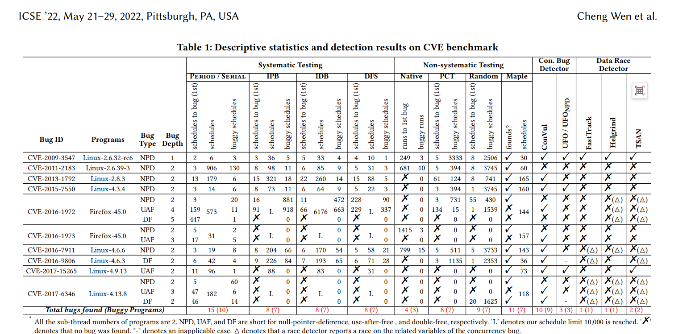
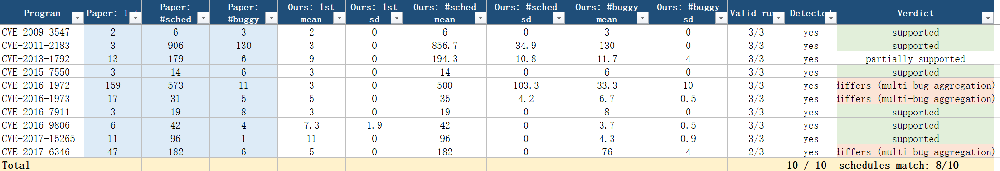

Claim 2 — Period detects all 10 buggy programs in the CVE benchmark (Table 1)

Table 1 in the original paper: 

Verdict: supported.

All ten programs were detected as buggy in every run (10/10, 30 runs total),
matching the paper's 10/10. The paper reports at most 7/10 for every baseline
CCT technique and 3/10 for native execution, so Period saturates the theoretical maximum on this benchmark.

Quantified gap.

the number of schedules explored matches the paper “exactly in
6 of 10 programs on the mean” and “in 8 of 10 programs in at least one run”;
the first-bug position matches in 6 of 10.

We ran each program three times. Six of them produced exactly the same number of schedules as the paper 
— 6, 14, 19, 42, 96 and 182 — and two more matched in at least one run. 

The four that did not match look like run-to-run variation rather than a mistake on our side. 

The crash count：the same schedule may fault in one run and not in the next. CVE-2016-7911 gave 9 in one run and 8 in the other two, and CVE-2017-15265 is reported as 1 in the paper but measured as 3–5 here. 
