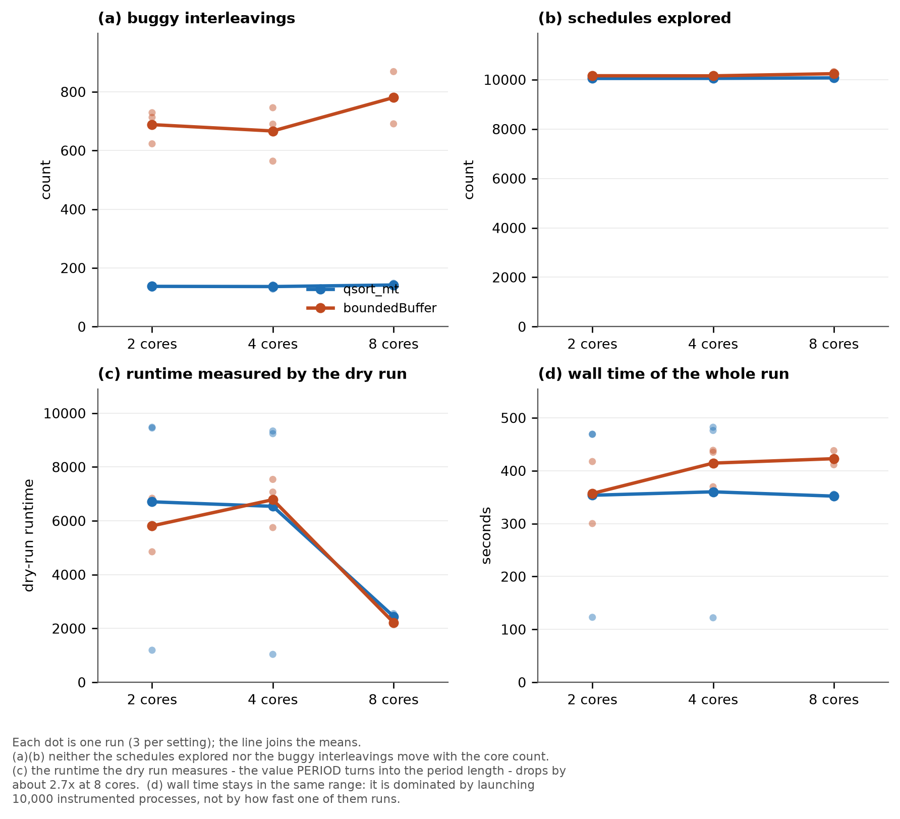

# Extension — how the number of CPU cores affects a PERIOD run

We ran two SCTBench programs under three core counts, everything else fixed:
`-y -d 3 -f 10000`, three runs per setting, same container image, same 16 GB.

The core count was changed by reconfiguring the virtual machine (1 socket, N
cores), not by pinning a process, so both the scheduler and the instrumented
programs see a genuinely smaller machine.

| Program | Cores | Buggy interleavings | Schedules explored | Dry-run runtime | Wall time |
|---|---|---|---|---|---|
| `qsort_mt` | 2 | 137.3 ± 5.5 | 10050 ± 26 | 6707 | 354 s |
| `qsort_mt` | 4 | 136.7 ± 7.6 | 10053 ± 5 | 6539 | 360 s |
| `qsort_mt` | 8 | 142.0 ± 5.6 | 10073 ± 9 | **2448** | 352 s |
| `boundedBuffer` | 2 | 688.3 ± 57.1 | 10159 ± 8 | 5813 | 357 s |
| `boundedBuffer` | 4 | 666.7 ± 93.2 | 10154 ± 4 | 6787 | 414 s |
| `boundedBuffer` | 8 | 780.7 ± 89.0 | 10242 ± 74 | **2222** | 423 s |

Per-run data is in `results/extension/cores.csv`; the raw logs are in
`logs/claim2log/period-logs-cores/` (2 and 4 cores) and
`logs/claim2log/period-logs-sct/` (8 cores).

What the data says:

1. **The number of schedules does not depend on the core count.** All six
   settings stay between 10 150 and 10 250; the spread (under 1 %) is smaller
   than the run-to-run spread we saw in the paper-replication runs. The
   enumeration space is a property of the program (threads × key points), not of
   the machine.
2. **The number of buggy interleavings shows no clear trend.** `qsort_mt` is
   flat (137 / 137 / 142) and `boundedBuffer` moves 688 → 667 → 781, but its
   standard deviation is 57–93, so the 8-core point is within one standard
   deviation of the 2-core point. With three runs per setting we cannot claim a
   core effect on detection.
3. **The runtime the dry run measures does depend on the core count**, and it
   drops by roughly 2.7× when going from 2 or 4 cores to 8 (`boundedBuffer`
   5813 / 6787 → 2222, `qsort_mt` 6707 / 6539 → 2448). This is the one metric
   that behaves as a parallelism story predicts: the same program, run once by
   the dry run, really does finish faster on a bigger machine.
4. **Wall time does not follow the core count**, because it is dominated by
   launching 10 000 instrumented processes rather than by how fast any one of
   them runs. Two runs finished in about two minutes while their neighbours took
   six to eight; per-schedule figures in `cores.csv` show the cost per schedule
   varying between 12 ms and 47 ms across runs with essentially identical
   schedule counts.

Interpretation: on this benchmark set, parallelism inside a period buys *speed
of the program under test*, not *coverage of the schedule space*. That is
consistent with what the paper claims for Period (it explores the same
systematic space as Serial, only without serialising execution), and it also
means a smaller machine does not silently weaken the testing results.

Caveat: three runs per setting are enough to rule out a large effect but not a
small one; `boundedBuffer`'s run-to-run spread (564–869 across all settings) is
wider than any difference between settings.
