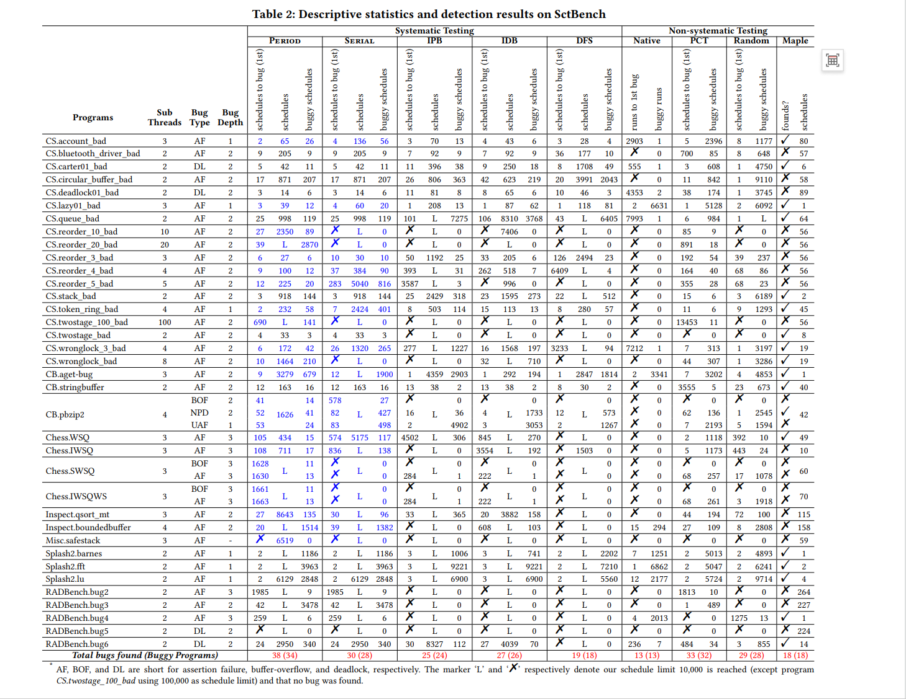
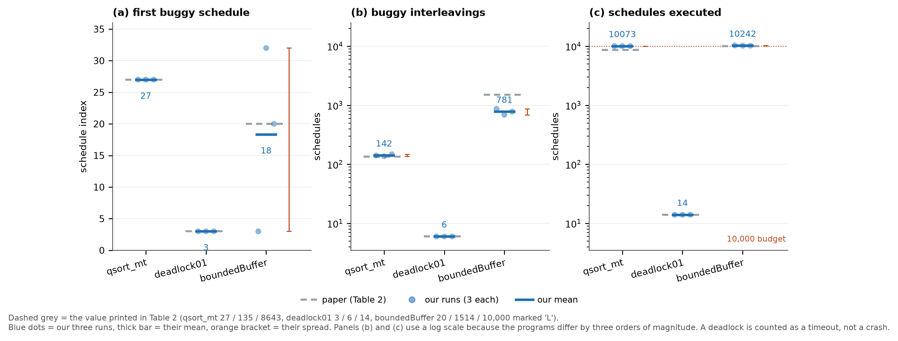

Claim 3 — Period detects the bugs in a sample of SCTBench programs (Table 2)

Table 2 in the original paper: 

Verdict: supported for Inspect.qsort_mt and CS.deadlock01, partially supported for
Inspect.boundedBuffer.

Setup. Three programs taken from two families of the SCTBench set shipped inside
the image: `Inspect_benchmarks/` (qsort_mt, boundedBuffer) and `CS/` (deadlock01).
We used the paper's setting for this benchmark, `-d 3`, with the 10,000-schedule
budget (`-f 10000`), three runs per program, in the same container and on the same
8 vCPU / 16 GB testbed as the CVE experiment. Deadlocks are reported by PERIOD as
timeouts rather than crashes, so for `deadlock01` the "buggy schedules" column is
the number of timeout interleavings.

| Program | Paper: first | Paper: #sched | Paper: #buggy | Ours: first | Ours: #sched | Ours: #buggy |
|---|---|---|---|---|---|---|
| Inspect.qsort_mt | 27 | 8643 | 135 | 27 / 27 / 27 | 10081 / 10064 / 10075 | 141 / 137 / 148 |
| Inspect.boundedBuffer | 20 | 10,000 (L) | 1514 | 3 / 32 / 20 | 10327 / 10202 / 10197 | 869 / 691 / 782 |
| CS.deadlock01 | 3 | 14 | 6 | 3 / 3 / 3 | 14 / 14 / 14 | 6 / 6 / 6 |

Quantified gap.

deadlock01 is reproduced exactly. The program has two threads and three key
points each, so the whole schedule space is 14 interleavings; all three runs walk
the same 14 schedules in the same order, time out on the same six of them, and
report their first deadlock on schedule 3. The three transcripts differ only in
the timing values and the output-directory name; each run takes about 30 seconds,
almost all of it the six 5-second timeouts.

qsort_mt reproduces the paper's detection point exactly: in all three runs the
first `[Error Found]` line appears on schedule 27, which is the number printed in
Table 2, and the run ends after roughly 10,000 schedules because it reaches our
budget rather than exhausting the space (paper: 8643). The number of buggy
interleavings is 142 on average against 135, a 5% difference.

boundedBuffer is the noisiest of the three. Its first-bug position moves between 3
and 32 across three runs and covers the paper's 20, with one run hitting 20
exactly. The schedule count reaches the same 10,000 limit the paper marks with
`L`. The buggy-interleaving count, however, is 781 on average against 1514, about
half of the paper's figure.

We attribute the boundedBuffer gap to the program itself rather than to the tool.
This program is a bounded buffer whose assertion fires when producer and consumer
interleave in a particular order, so how many of the explored schedules actually
crash depends on the order in which the same 10,000 schedules are enumerated, and
that order is not stable across runs on a machine with fewer cores than the one
used in the paper (8 vCPU here, 12 cores / 24 threads there). The other two
programs are far less sensitive: deadlock01 is small enough to be exhausted
deterministically, and qsort_mt fails only through a narrow verification path, so
all three of its runs give the same first-bug position and counts within 8%.

Note also that one earlier boundedBuffer attempt aborted during PERIOD's dry run
(the assertion fired under the default schedule, so the tool could not collect the
thread and key-point information) and was excluded; the harness retried
automatically. This is the same failure mode we saw once on CVE-2017-6346.

Files. The nine run logs and the two build logs are in
`logs/claim2log/period-logs-sct/`:

- `qsort_mt_d3_run1..3.log`, `boundedBuffer_d3_run1..3.log`,
  `deadlock01_d3_run1..3.log`
- `batch_qsort.log`, `batch_boundedBuffer.log`

Limitations. Three of the 36 SCTBench programs are covered here, from two of the
seven families (`Inspect` and `CS`); CB, Chess, RADBench, SafeStack and Splash2
are not attempted. We ran three repetitions per program where the paper uses ten,
and the testbed has fewer cores than the paper's workstation.

Runtime. One qsort_mt run takes about 6 minutes and one boundedBuffer run about 7
minutes (boundedBuffer carries a longer per-schedule cost because the assertion
has to be reached inside the buffer logic); one deadlock01 run takes about 30
seconds, of which roughly 30 are the six 5-second timeouts. Including the aborted
dry-run attempt and the rebuilds, producing three runs of each program took about
50 minutes in total.
